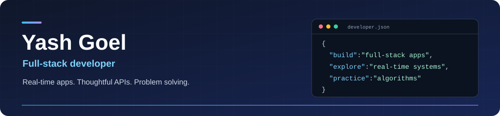

  

<h1 align="center">Hi, I'm Yash Goel</h1>

  I build full-stack applications with React, Next.js, TypeScript, and PostgreSQL. 
  My projects explore real-time collaboration, offline synchronization, and backend development.

  
  
  
  

## About me

- Computer Science and Engineering student at Chandigarh University.
- Interested in software engineering opportunities and full-stack development.
- I work with WebSockets, REST APIs, authentication, relational databases, and automated tests.
- I practice data structures and algorithms in C++.

## Selected projects

### SyncSave

**An offline-first collaborative editor with a shared whiteboard.**

Edit documents together with live cursors, work offline, and synchronize changes when the connection returns.

- Yjs CRDTs coordinate concurrent edits; IndexedDB stores local document state.
- WebSocket-level permissions support owners, editors, and viewers, including live access revocation.
- PostgreSQL stores document state through debounced, sequential writes.

TypeScript · Next.js · Node.js · Yjs · WebSockets · PostgreSQL · Prisma

[View code](https://github.com/yashgoel-749/SyncSave) · [Open demo](https://syncsave.vercel.app)

### LinkFlow

**A URL shortener with link management and click analytics.**

Create custom short links with expiration, password protection, and QR codes, then inspect redirect activity.

- Redis caches redirect lookups, with PostgreSQL fallback and cache invalidation.
- JWT sessions use HttpOnly cookies; ownership checks and Zod validation protect API operations.
- Backend integration tests and Playwright cover authentication, links, redirects, and analytics.

TypeScript · React · Express · PostgreSQL · Prisma · Redis · Playwright

[View code](https://github.com/yashgoel-749/linkflow)

### Amazon clone

**A full-stack storefront with a complete simulated shopping flow.**

Browse products, search the catalog, save a wishlist, and manage a persistent cart through checkout and order history.

- Next.js and React Context manage the storefront, cart, authentication, and wishlist.
- Express APIs and PostgreSQL store users, products, carts, addresses, and orders.
- Google sign-in and JWT authentication support account access. Checkout is simulated, not a real payment integration.

JavaScript · Next.js · React · Node.js · Express · PostgreSQL · JWT

[View code](https://github.com/yashgoel-749/clone)

  
Also built: ClinIQ

### ClinIQ

A research demo for emergency triage and patient flow. Eight rule-based Python agents produce suggestions for explicit human review, with evidence traces and an audit history.

It uses fictional adult data only. It is not a diagnostic system or a tool for clinical care.

Python · FastAPI · React · PostgreSQL · SQLAlchemy · pytest

[View code](https://github.com/yashgoel-749/AI_PATIENT) · [Open demo](https://ai-patient-chi.vercel.app)

## Tools I use

  

| Area | Technologies |
| :--- | :--- |
| Languages | C++, Python, JavaScript, TypeScript, SQL |
| Frontend | React, Next.js, HTML, CSS, Tailwind CSS |
| Backend | Node.js, Express, FastAPI, REST APIs, WebSockets |
| Data and synchronization | PostgreSQL, Redis, Prisma, Yjs, IndexedDB |
| Testing and deployment | Playwright, pytest, Git, Docker, Vercel, Render |

## Problem solving and achievements

I practice algorithms on [LeetCode](https://leetcode.com/u/goelyash749/) and [Codeforces](https://codeforces.com/profile/yashgoel__). My interests include data structures, database design, and operating systems.

- 2nd runner-up at Hackshastra 2.0, a national-level hackathon.
- 1st runner-up at Technicia '25.
- Top 5 in Aptitude Wizard Season 22 among 200+ participants.

---

  <a href="mailto:goelyash749@gmail.com">Get in touch</a> ·
  <a href="https://linkedin.com/in/yash-goel-633446277">LinkedIn</a> ·
  <a href="https://github.com/yashgoel-749?tab=repositories">Explore my repositories</a>

